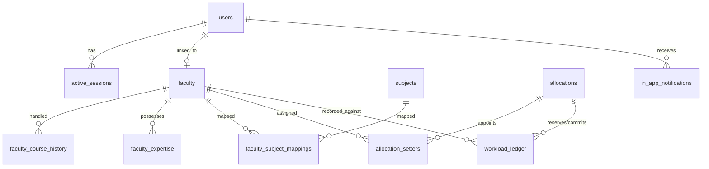

# ExamExpert AI — Database Schema Specification
**SJB Institute of Technology, Bengaluru | Autonomous MCA Major Project**  
**Office of the Controller of Examinations (COE)**  

This document details the relational SQLite database architecture, entity models, constraints, and relationships implemented via SQLAlchemy ORM.

---

## 1. Entity-Relationship Overview

---

## 2. Table Specifications

### 2.1 `users` (System User Accounts)
Tracks administrative, departmental, and faculty portal accounts.
- `id` (INTEGER, Primary Key, Autoincrement)
- `username` (VARCHAR(50), Unique, Indexed, Non-Nullable)
- `email` (VARCHAR(200), Unique, Indexed, Non-Nullable)
- `password_hash` (VARCHAR(255), Non-Nullable) — Bcrypt salted hash
- `role` (VARCHAR(50), Non-Nullable) — `'Admin'` | `'HOD'` | `'Faculty'`
- `department` (VARCHAR(200), Nullable) — Department code (e.g. `'MCA'`, `'CSE'`)
- `full_name` (VARCHAR(200), Nullable)
- `phone` (VARCHAR(30), Nullable)
- `faculty_id` (INTEGER, ForeignKey(`faculty.id`, ondelete='SET NULL'), Nullable)
- `is_active` (BOOLEAN, Default: `True`)
- `is_activated` (BOOLEAN, Default: `True`)
- `is_locked` (BOOLEAN, Default: `False`) — Brute force lockout flag
- `failed_attempts` (INTEGER, Default: `0`)
- `created_at` (DATETIME, Default: `utcnow`)

### 2.2 `active_sessions` (Session Revocation & Tokens)
Tracks active JWT tokens for server-side revocation upon logout.
- `id` (INTEGER, Primary Key, Autoincrement)
- `user_id` (INTEGER, ForeignKey(`users.id`, ondelete='CASCADE'), Indexed)
- `token` (VARCHAR(500), Unique, Indexed, Non-Nullable)
- `is_revoked` (BOOLEAN, Default: `False`)
- `expires_at` (DATETIME, Non-Nullable)
- `created_at` (DATETIME, Default: `utcnow`)

### 2.3 `faculty` (Institutional & External Faculty Roster)
Profiles of faculty candidates eligible for question-paper setting.
- `id` (INTEGER, Primary Key, Autoincrement)
- `db_serial_no` (VARCHAR(50), Unique, Indexed, Nullable)
- `employee_id` (VARCHAR(50), Indexed, Nullable)
- `name` (VARCHAR(200), Non-Nullable, Indexed)
- `designation` (VARCHAR(100), Nullable)
- `department` (VARCHAR(200), Nullable, Indexed)
- `institution` (VARCHAR(300), Nullable, Indexed)
- `faculty_type` (VARCHAR(20), Non-Nullable) — `'internal'` | `'external'`
- `qualification` (VARCHAR(100), Nullable) — e.g. `'Ph.D'`, `'M.Tech'`, `'MCA'`
- `experience_years` (FLOAT, Nullable) — Total teaching experience
- `eligibility_status` (VARCHAR(50), Default: `'Eligible'`) — `'Eligible'` | `'Not Eligible'` | `'Cannot Verify'`
- `email` (VARCHAR(200), Nullable)
- `mobile` (VARCHAR(50), Nullable)
- `created_at` (DATETIME, Default: `utcnow`)

### 2.4 `subjects` (Curriculum & Syllabus Master)
Course catalog across academic years, schemes, and departments.
- `id` (INTEGER, Primary Key, Autoincrement)
- `course_code` (VARCHAR(50), Indexed, Nullable)
- `title` (VARCHAR(300), Non-Nullable, Indexed)
- `department` (VARCHAR(200), Non-Nullable, Indexed)
- `scheme` (VARCHAR(50), Nullable) — e.g. `'2025'`, `'2022'`
- `academic_year` (VARCHAR(50), Nullable) — e.g. `'2025-26'`
- `semester` (VARCHAR(20), Non-Nullable) — e.g. `'I'`, `'II'`, `'III'`, `'IV'`
- `course_type` (VARCHAR(50), Default: `'Theory'`)
- `credits` (INTEGER, Default: `4`)
- `verification_status` (VARCHAR(100), Default: `'Verified'`)
- `created_at` (DATETIME, Default: `utcnow`)

### 2.5 `faculty_subject_mappings` (Expertise Mappings)
Curricular expertise alignment between faculty and subjects.
- `id` (INTEGER, Primary Key, Autoincrement)
- `faculty_id` (INTEGER, ForeignKey(`faculty.id`, ondelete='CASCADE'), Indexed)
- `subject_id` (INTEGER, ForeignKey(`subjects.id`, ondelete='CASCADE'), Indexed)
- `mapping_type` (VARCHAR(50), Indexed) — `'EXACT_EXPERIENCE'` | `'SPECIALIZATION'` | `'RELATED'`
- `status` (VARCHAR(30), Default: `'SUGGESTED'`, Indexed) — `'SUGGESTED'` | `'CONFIRMED'` | `'REJECTED'`
- `suggestion_reason` (VARCHAR(500), Nullable)
- `times_handled` (INTEGER, Default: `0`)
- `is_confirmed` (BOOLEAN, Default: `False`)
- `confirmed_by` (VARCHAR(100), Nullable)
- `confirmed_at` (DATETIME, Nullable)
- `created_at` (DATETIME, Default: `utcnow`)

### 2.6 `allocations` & `allocation_setters` (Orders & Appointments)
- `allocations`: Stores parent order header with academic year, department, subject, exam type, ratio, and workflow status (`'Draft'`, `'Pending HOD Approval'`, `'Confirmed'`, `'Rejected'`, `'Cancelled'`).
- `allocation_setters`: Individual setter appointments linking `allocation_id` to `faculty_id`, recording role (`'Internal Setter'` / `'External Setter'`), replacement provenance, and rank criteria.

### 2.7 `workload_ledger` (Append-Only Workload Accounting)
Maintains audit trail of all faculty paper-setting capacity commitments:
- `id` (INTEGER, Primary Key, Autoincrement)
- `faculty_id` (INTEGER, ForeignKey(`faculty.id`, ondelete='CASCADE'), Indexed)
- `allocation_id` (INTEGER, ForeignKey(`allocations.id`), Indexed)
- `academic_year` (VARCHAR(50), Non-Nullable)
- `state` (VARCHAR(30), Non-Nullable) — `'RESERVED'` | `'COMMITTED'` | `'RELEASED'`
- `delta` (INTEGER, Default: `1`)
- `notes` (TEXT, Nullable)
- `created_at` (DATETIME, Default: `utcnow`)

### 2.8 `in_app_notifications` & `audit_logs`
- `in_app_notifications`: User-scoped alerts for allocations, approvals, and appointments.
- `audit_logs`: Immutable, system-wide log of all administrative and workflow state transitions (`action`, `entity_type`, `entity_id`, `details`, `performed_at`).
